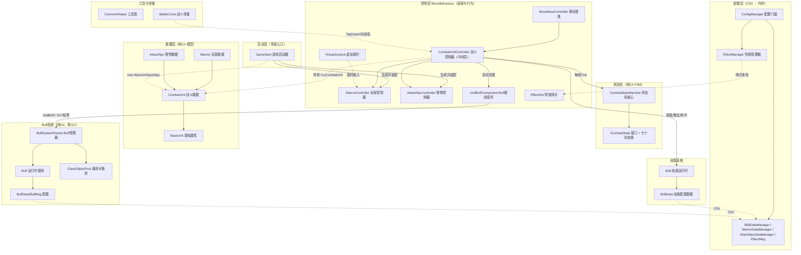
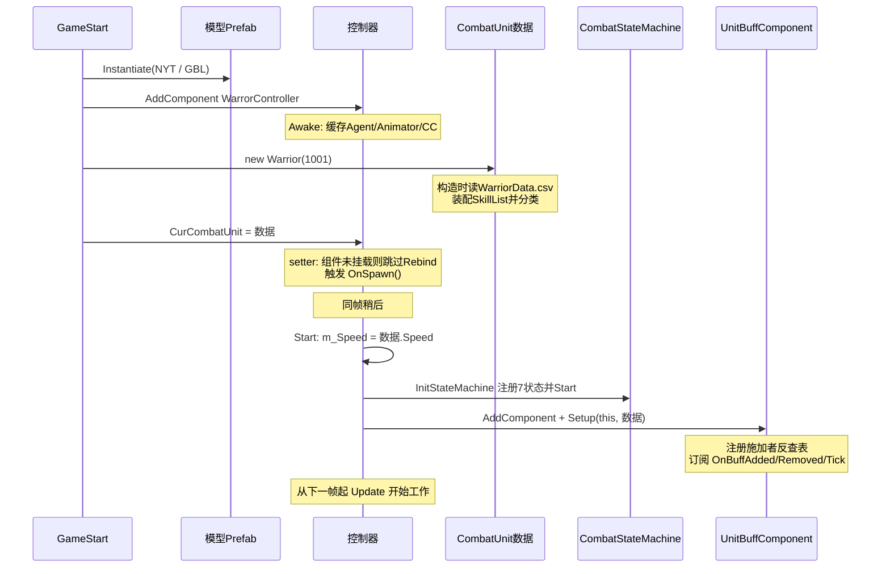
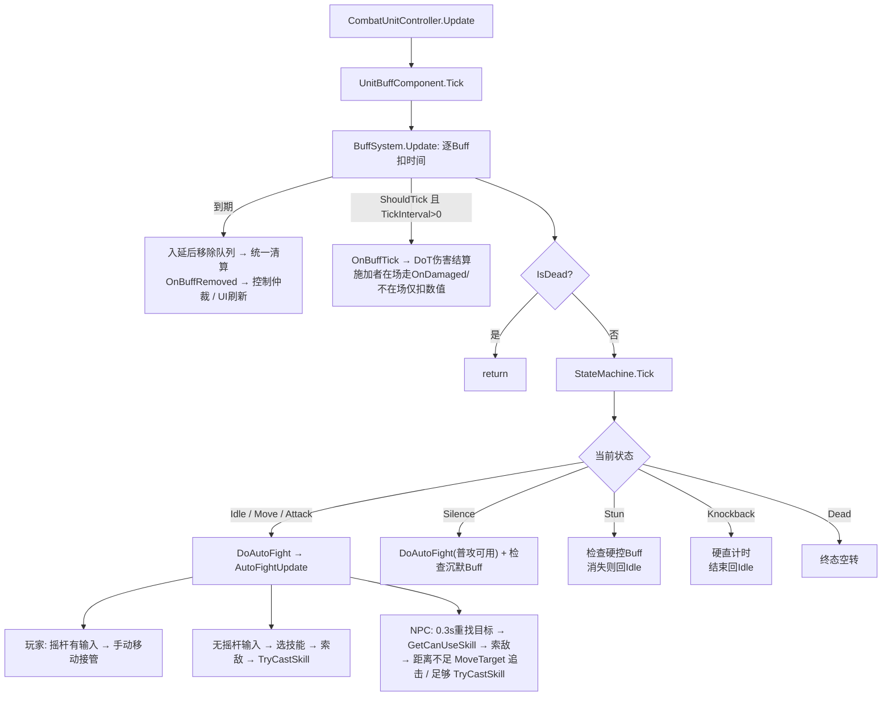
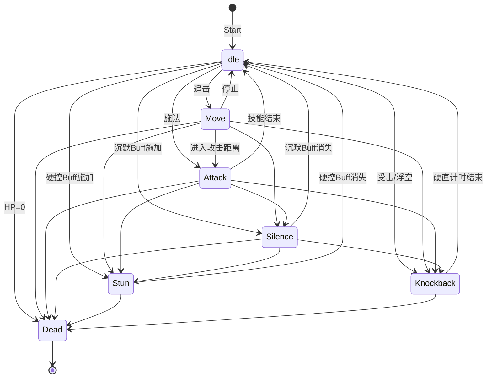
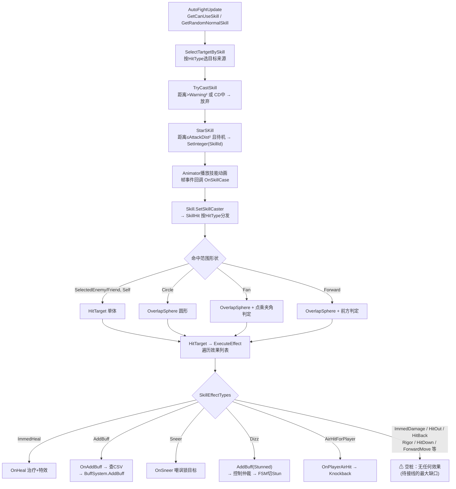
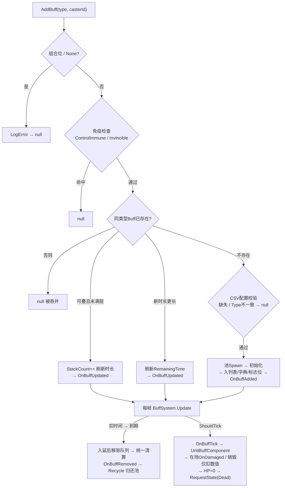
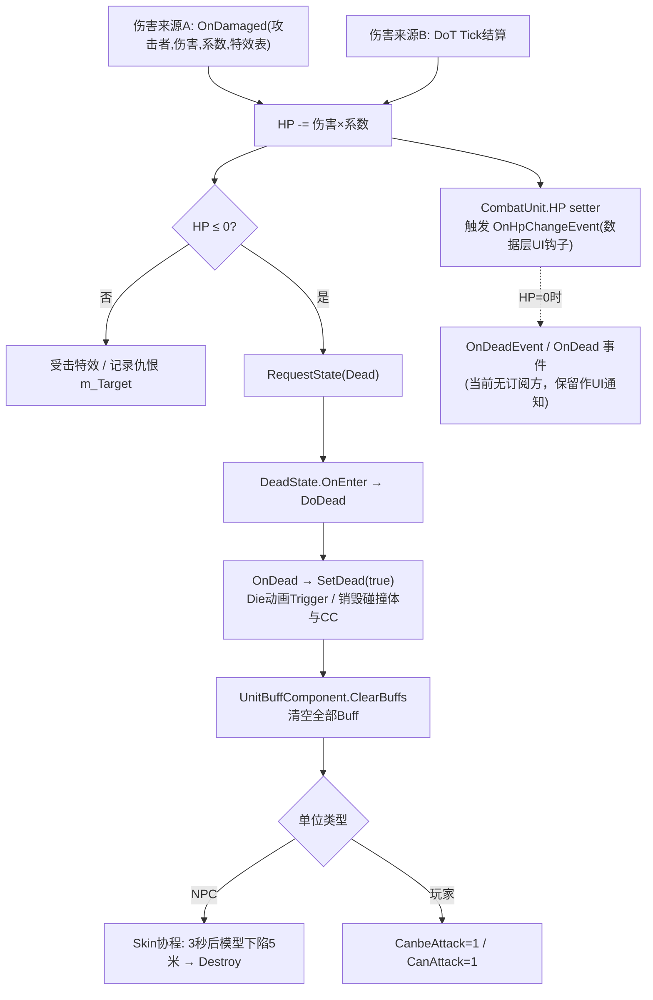

# 战斗框架（BattleFramework）技术文档

> **文档位置**：`Assets/战斗框架技术文档.md`
> **撰写日期**：2026-09-07（基于当前代码实际状态）
> **配套文档**：
> - `Assets/战斗框架分析报告.md` —— 问题清单与修复记录（历史）
> - `Assets/Scripts/BattleFreamwork/BufferSystem/BuffSystem_使用说明.md` —— Buff 系统专项文档
>
> **适用版本**：Unity 2023.2.20f1c1
> **技术栈**：NavMeshAgent + CharacterController + Animator（Root Motion 驱动）+ CSV 配置驱动 + ulong 位枚举 Buff + 纯 C# 状态机

---

## 目录

1. [总体架构](#1-总体架构)
2. [类详解](#2-类详解)
3. [战斗系统流程图](#3-战斗系统流程图)
4. [使用说明](#4-使用说明)
5. [附录](#5-附录)

---

## 1. 总体架构

### 1.1 架构分层图



### 1.2 核心设计思想

| 思想 | 落地 |
|------|------|
| **数据与行为分离（MVC 变体）** | 数据层（`CombatUnit` 系，纯 C#）+ 控制层（`*Controller` 系，MonoBehaviour），双方通过 `CurCombatUnit` 属性连接 |
| **配置驱动** | 技能/角色/怪物/Buff/特效全部 CSV（`Resources/Config/`），策划改表不改码 |
| **位标志 + O(1) 查询** | 46 种 Buff 压缩进一个 `ulong`；`HasBuff/CanMove` 等全是位运算 |
| **Buff 是控制效果唯一真相源** | 时长/叠加/免疫/驱散全在 Buff 系统；FSM 的 Stun/Silence 只是它的投影 |
| **事件驱动表现层** | 血量变化/出生/死亡/Buff 增删/Tick 全部有事件，UI/特效只订阅不动核心 |
| **对象池零 GC** | Buff 走 `ClassObjectPool<Buff>`；特效走 `EffectManager` 字典缓存 |

---

## 2. 类详解

> 按层组织。每个类给出：**职责 / 关键成员 / 设计意义 / 注意事项**。

### 2.1 数据层（`BattleData/`）

#### BaseUnit
- **职责**：所有战斗对象的最基础属性容器。
- **关键成员**：`Name / Level / Height / Radius / Speed / Modle`（模型资源名）、`m_UnitObj`（游戏对象引用）。
- **意义**：把"模型无关的通用属性"沉到最底层，供 UI 展示与逻辑复用。
- **注意**：`Modle` 为拼写错误（应为 Model），历史遗留，全局重命名时一并处理。

#### CombatUnit（战斗数据核心）
- **职责**：战斗单位的共有数据与生命周期事件。
- **关键成员**：
  - `HP` setter —— **整个框架的心脏之一**：写血量时自动触发 `OnHpChangeEvent`，血量为 0 时触发 `OnDeadEvent / OnDead`（数据层死亡通知，UI 专用）。
  - 事件：`OnHpChangeEvent / OnRageEvent / OnDeadEvent / OnDead / OnSpawnEvent`。
  - `BuffSystem`（懒属性）—— 本单位专属的 `BuffSystemPooled`，首次访问时创建；共享全局静态池（容量 200，仅建一次）。**挂在数据层的意义**：`Warrior.Damage` 这类纯数据 getter 未来可直接叠加 Buff 加成。
  - `SkillList / NorSkillList / AttackSkillList / SuperSkillList / IsUseSkill` —— 技能实例与分类清单。
  - `CantAttack / CanbeAttack` —— 0 表示可攻击/可被攻击。
  - `Rage`（怒气）—— 实例字段（曾为 static 全局共享 Bug，已修复）。
- **意义**：Model 层与 Controller 层的契约点；事件让 UI 与战斗逻辑彻底解耦。
- **注意**：`GetSkill(id)` 线性查找；`GetRandomNormalSkill()` 内部用 `CommonHelper.RandomObject`，有装箱分配（冷路径可接受）。

#### Warrior（玩家数据）
- **职责**：包装 `WarriorData`（CSV），暴露玩家属性与技能分类。
- **关键成员**：`ID / Damage / Defend / Crit / Parry / Penetrate / MaxHP / Speed / Spring(索敌半径) / MoveSpring(移动警戒)`；构造函数按 `WarriorData.SkillArray` 装配技能并分类；`GetSuperSkill()` 按 `BpNeed` 挑选可用大招。
- **注意**：**属性 getter 无 null 兜底**（配置缺失时 `WarriorBaseData.Atk` 直接 NRE）——与 `AttackNpc` 风格不一致，属已知待修项。

#### AttackNpc（怪物数据）
- **职责**：包装 `AttackNpcData`（CSV），同上但 **全部 getter 带 null 兜底**（返回 0），风格可作为 `Warrior` 修复的模板。

#### BuffData / BuffMsg（`BuffData.cs`）
- **职责**：Buff 配置表结构与解析器。
- **关键成员**：`BuffMsg` 解析 `Config/BufferData.csv`（**CRLF 行尾依赖**），加载时校验：非法 Duration（只能 -1 或 >0）、重复 Id、重复 BuffType —— 均报 Error 并跳过该行；`GetData` 返回 null 而非抛异常。
- **意义**：Buff 的"数据驱动"入口；脏数据在加载期被拦截。

---

### 2.2 控制层（`Controller/`）

#### MoveBaseController（移动基类）
- **职责**：一切移动能力的底座。
- **关键成员**：
  - `Awake` 缓存 `NavMeshAgent / Animator / CharacterController`。
  - `SetDestination / StopMove / RotateToTarget`。
  - `OnAnimatorMove`（Root Motion 回调）：需要 `Animator.Apply Root Motion` 勾选；有 NavMeshAgent 且 `NeedMove` 时驱动 `NavmeshMove` 并维护 `Move` 动画布尔。
  - `NavmeshMove`：NPC 按 `steeringTarget` 旋转 + `Agent.Move`；**Player 分支则无视朝向沿世界 +Z 移动**（历史设计，玩家实际移动走摇杆路径）。
  - `PlayerMove(bool)` / `PlayMoveForward`（`RunF` 动画 + `cc.SimpleMove(forward*5)`）/ `PlayMoveBackUp`（`RunB` + 倒退）。
- **注意**：
  - `OnAnimatorMove` 内残留 `Debug.LogError(4444)`（每帧刷屏）与 `RunAttB` 硬编码动画名 —— 待清理项。
  - `Update` 残留按 `A` 键 `SetDestination` 的调试代码 —— 对带 Agent 的单位是真实移动指令。

#### CombatUnitController（战斗控制器，框架中枢）
- **职责**：承接一切战斗行为的中间层。玩家/NPC 控制器的公共父类。
- **关键成员**（按功能域）：
  - **单位绑定**：`CurCombatUnit` setter（重绑 Buff 组件 + 触发 `OnSpawn`）。
  - **Buff 接线**：`m_BuffComponent`（Start 自动挂载 `UnitBuffComponent`）；`OnAddBuff(attacker, skill, buffid)` —— 技能命中挂 Buff 的桥：按配置 Id 查 CSV → `BuffSystem.AddBuff(type, attacker.GetInstanceID())`。
  - **索敌四策略**：`FindTargetInRadius_MinDistance / _Random / _MinHp`（按 `Spring` 攻击半径）与 `FindTargetForMove_MinDistance`（按 `MoveSpring` 警戒半径）；均 `Physics.OverlapSphere` + `for` 遍历（避免 foreach GC）。
  - **技能施放**：`SelectTartgetBySkill`（按技能 HitType 决定目标来源）→ `TryCastSkill`（距离/CD 检查；NPC 走 `PrepareAttack` 转身+停走）→ `StarSKill`（距离/待机检查 → `SetInteger("SkillId")` 驱动动画）。
  - **伤害管线**：`OnDamaged(attacker, hp, DamageCoe, hitEffects)` —— 扣血（`hp×DamageCoe`）、播受击特效、记录仇恨（`m_Target = attacker`）、`Hp<=0 → RequestState(Dead)`。**死亡的唯一入口**。
  - **受击接口族**：`OnHitOut / OnPlayerAirHit / OnAirHit`（击退浮空 → `RequestState(Knockback)`）；`OnDizz / OnSilence`（**统一走 Buff 系统**：`AddBuff(Stunned/Silenced)` 并用调用方时长覆盖 `buff.RemainingTime`，免疫/叠加/驱散天然生效）；`OnSneer`（嘲讽锁目标）；`OnHeal`。
  - **死亡**：`OnDead → SetDead(true)`（`Die` Trigger + 销毁 CapsuleCollider/CharacterController）→ `ClearBuffs`；`DoDead()` 供 DeadState 调用。
  - **FSM 桥接**：`InitStateMachine / RequestState / NavStop / ResetSkillId / SetMoveAnim / DoAutoFight / DoDead`。
  - **查询**：`IsIdleToUseSkill`（`SkillId==0` 且无过渡 = 待机可操作）、`HasHardControlBuff / HasSilenceBuff`（转发给 Buff 组件）、`HasStateMachine`。
- **意义**：框架的" ApplicationController"——所有战斗用例在此汇合。
- **注意**：`IsUseAttSkill` 引用 `BattleConst.ani_IdleC`；`EnemyState / WarriorState` 两个旧枚举仍在文件头（已被 `CombatState` 取代，待删）。

#### UnitBuffComponent（Buff 接线组件）
- **职责**：从 `CombatUnitController` 拆出的独立 MonoBehaviour——**Buff 事件订阅 / DoT 结算 / 施加者反查表 / 控制状态仲裁**。
- **关键成员**：
  - `Setup(owner, unit)`：绑定并注册反查表；`Rebind(unit)`：数据变更时重订（修复晚绑定漏订阅）。
  - `Tick(dt)`：由 Controller 的 Update 调用（保证先于 FSM Tick），内部驱动 `BuffSystem.Update`。
  - `ClearBuffs()`（死亡清空）、`Shutdown()`（销毁退订+清空）。
  - 静态 `FindControllerById(casterId)`：DoT 结算按 CasterId 找回施加者。
  - `OnBuffTickDamage`：施加者在场走 `OnDamaged` 完整管线；已销毁仅扣数值。
  - `SyncControlStateFromBuffs`：**控制状态仲裁**——有硬控 Buff（眩晕/冰冻/石化/睡眠）→ Stun；有沉默 → Silence；都无 → 回 Idle。
- **意义**：主类瘦身（1302→约1170行）+ 单一职责；一个战斗单位一个组件，Inspector 可见。
- **注意**：无自己的 `Update`（生命周期由 Controller 显式驱动，避免 Unity 消息顺序坑）；`OnDestroy` 只做兜底清理。

#### WarrorController（玩家控制器）
- **职责**：玩家行为——摇杆移动 + 自动战斗。
- **关键成员**：
  - `JoystickMoveUpdate()`：读 `VirtualJoystick.Instance`，有输入时旋转（720°/s）+ `CharacterController.Move(-forward × m_Speed × 摇杆力度)`（**无重力版 Move**：场景无地面时避免坠落）+ `Run` 动画；输入期间跳过自动索敌。被 Stun/Knockback/Dead 状态天然拦截（这些状态不调 `DoAutoFight`）。
  - `GetCharacterController()`：玩家预制体没有 CC 时**动态补挂**，尺寸对齐 CapsuleCollider。
  - `AutoFightUpdate()`：摇杆优先 → 待机检查 → `GetRandomNormalSkill` → 索敌 → `TryCastSkill`。
  - `PlayerNeedMove`：getter 内含 OverlapSphere（已知性能点，待限频）。
- **注意**：类名拼写 `Warror`（应为 Warrior）——历史遗留。

#### AttackNpcController（怪物控制器）
- **职责**：怪物 AI——自动索敌与攻击。
- **关键成员**：`AutoFightUpdate`：每 0.3s 清空 `m_Target` 强制重找 → `GetCanUseSkill` → 索敌 → `TryCastSkill` → 距离不足时 `MoveTarget`（NPC 走 NavMesh 追击）。`OnDead`：`base.OnDead()` 后启动 `Skin` 协程（3 秒后模型下陷 5 米 → `Destroy`）。`UniqueID` 用 `CommonHelper.GetUniqueID(gameObject)`。
- **意义**：展示"子类只重写差异"的多态模式（`EnemyLayer/EnemyTag`）。

#### VirtualJoystick（虚拟摇杆）
- **职责**：UI 摇杆——拖动限制半径、对外暴露 `Direction / Magnitude / IsDragging`，静态 `Instance`。
- **注意**：挂在场景 `Canvas→Joystick` 物体上，`Knob` 引用摇杆头。**当前 SampleScene 中不存在该 UI**（场景曾被重置），装配步骤见[4.6](#46-摇杆-ui-装配)。

#### EffectDot（特效绑点）
- **职责**：模型上的特效挂点登记表。`DotList` → 按名字建字典；`GetEffectDot(name)` 供特效绑定。
- **注意**：`Start` 里有调试调用 `msg.GetData(10001)`（残留）。

---

### 2.3 状态机（`StateMachine/`）

#### CombatState + ICombatState（`CombatState.cs`）
- **职责**：七状态枚举（`Idle/Move/Attack/Stun/Silence/Knockback/Dead`）+ 状态接口（`OnEnter/OnUpdate/OnExit`）。
- **意义**：**取代**了散落未用的 `EnemyState / WarriorState` 旧枚举，成为状态唯一真相源。

#### CombatStateMachine
- **职责**：状态注册表 + **转换合法性表**（`InitDefaultTransitions` 定义七状态全部合法转换；Dead 为终态无出边）+ `ChangeState`（校验 → 旧 OnExit → 新 OnEnter → `OnStateChanged` 事件）+ 每帧 `Tick`。
- **注意**：`context` 参数可携带受控时长（Knockback 用 float）。

#### CombatStates（七个状态实现）
| 状态 | OnEnter | OnUpdate 逻辑 |
|------|---------|-------------|
| IdleState | NavStop + ResetSkillId | `DoAutoFight` |
| MoveState | SetMoveAnim(true) | `DoAutoFight` |
| AttackState | — | `DoAutoFight` |
| StunState | NavStop + ResetSkillId | **查询硬控 Buff 是否仍在**，消失 → 回 Idle（时长归 Buff 管） |
| SilenceState | IsSilenced=true | `DoAutoFight`（普攻/移动可用）+ 查询沉默 Buff，消失 → Idle |
| KnockbackState | NavStop + 计时（context float） | 计时结束 → Idle（**唯一自带计时的控制状态**，未走 Buff） |
| DeadState | `DoDead()` | 空转（终态） |

---

### 2.4 技能系统

#### Skill（运行时技能对象）
- **职责**：一次技能释放的执行器。
- **关键流程**：
  1. `SetSkillCaster(caster, target)` 绑定施放者与目标（由动画事件 `OnSkillCase` 回调时设置）。
  2. `SkillHit(DamageCoe, dotBack, ...)`：按 `HitType` 分发（单体/范围/自身），范围再按形状（圆形/扇形/直线）`Physics.OverlapSphere` 取目标。
  3. `HitTarget` → `ExecuteEffect`：遍历 `EffectListType`（效果类型列表）逐一执行对应方法。
- **伤害公式**（`GetSkillDamage / GetSkillOneDamage`，已实现）：
  ```
  穿透系数 = (100 + 攻击方Penetrate/400 - 受击方Parry/400) / 100
  防御系数 = (12000 + Defend) / (12000 + Defend×10)
  基础伤害 = round(攻击方Damage × 防御系数 × 穿透系数 × 技能Attack系数)，最低1
  暴击：OnProbability(Para2) 命中 → ×1.5（注意：Para3 注释写"暴击倍率"但代码硬编码1.5，待对齐）
  最终 = round(基础伤害 / DamageCoe)
  ```
- **效果方法落地状态**（诚实清单）：

| SkillEffectTypes | 方法 | 状态 |
|---|---|---|
| ImmedHeal=1 | `ImmedHeal` → `OnHeal` | ✅ 已落地 |
| AddBuff=2 | `AddBuff` → `unit.OnAddBuff` → CSV → BuffSystem | ✅ 已落地 |
| Sneer=3 | `Sneer` → `OnSneer` | ✅ 已落地 |
| Dizz=9 | `OnDizz` → `BuffSystem.AddBuff(Stunned)` → FSM 仲裁 | ✅ 已落地 |
| AirHitForPlayer=21 | `OnAirHitForPlayer` → `OnPlayerAirHit`(Knockback) | ✅ 已落地 |
| **ImmedDamage=0（直接伤害）** | `ImmedDamage` | ⚠ **空桩** |
| Rigor=4 / HitOut=5 / HitBack=6 / HitOutDown=7 / HitDown=8 / ForwardMove=10 / OneUnitHitBack=11 / OnSetUnitEnable=12 / ViolenceToGrab=13 / AirHit=14 / DownHit=15 / OnUnitMove=16 / 17 / 18 / Frozen=19 / SetRotate=20 / Hure=22 | 对应方法 | ⚠ **空桩** |

  > **这是当前框架最大的未完成项**：技能命中后只有"治疗/挂Buff/嘲讽/眩晕/对玩家浮空"会真实发生，**直接伤害与大部分受击表现不会发生**。修复成本低（大多一行 `RequestState` 或调用 `OnDamaged`）。

- **注意**：`SetCD` 依赖被注释掉的 TimerManager，`CoolDown` 置 true 后**无人复位**（CD 系统未接）。

#### SkillData（技能配置）+ 管理器
- **职责**：CSV 行 → 内存对象；字段语义：
  - `SkillType`（普通/攻击/大招）、`SkillThrowType`（投技优先级）、`CDTime / AttackDist / Warning(警戒距离) / HitNum(命中数上限) / AttackRadius / AttackAngle`。
  - `SkillEffectTypes`：**效果类型列表**（决定 ExecuteEffect 走哪些分支）。
  - `HitEffect`：受击特效 Id 列表。
  - `Para2` 暴击率、`Para4/Para5` 治疗量/治疗特效、`Para6` **Buff 配置 Id 列表**、`Para7~10` 后退距离/时间/浮空距离/时间、`Para15` 眩晕时间、`Para16` 大招伤害次数。
- **注意**：解析用裸 `int.Parse/float.Parse`（列错位即异常，待加固）；列顺序以 `SkillData.cs → LoadSkillData()` 为准。

---

### 2.5 Buff 系统（`BufferSystem/`，详见 `BuffSystem_使用说明.md`）

#### BuffType
- 46 种 Buff 用 `ulong` 位标记（1<<0 ~ 1<<45）+ 组合标记（`AllPositive/AllNegative/AllControlEffects/AllDamageOverTime/AllMovementImpair`）。从 `1UL<<46` 起可扩展。

#### Buff
- 运行时载体：`_BuffData`（配置引用）+ `RemainingTime/StackCount/NextTickTime/CasterId/IsActive/CreatedTime`。
- **失效引用安全**：回收后（`_BuffData==null`）`IsExpired()` 返回 true、`ShouldTick()` 返回 false。

#### BuffSystemPooled
- 每单位一个的管理器。**入口唯一**：`AddBuff(BuffType, casterId)`（参数全来自 CSV）。
- 防护齐全：单一类型校验（拒组合位）/ 免疫检查（ControlImmune/Invincible）/ 同类型叠加或刷新或吞并 / 配置校验（缺失或 Type 不一致 → null）。
- **延后移除队列**（`_pendingRemove` + `_iterating/_draining` 双重入保护）：事件回调里再调 Add/Remove/Clear 都安全。
- 时钟空闲归零（防 float 精度漂移）；`Update` 内过期入队、统一清算、Tick 触发。
- 零 GC：移除/驱散全循环实现；`GetBuffsByCategory(c, buffer)` 填充式查询。

#### ClassObjectPool<T>
- 通用类对象池：构造预热、`Spawn(creatIfPoolEmpty)`、`Recycle`（池满拒绝、计数不漂移、**编辑器下 HashSet 重复回收检测**）。

---

### 2.6 配置与特效（`ConfigData/`、`Scripts/ConfigData/`）

#### ConfigManager
- 静态门面，懒加载五个数据管理器：`GetSkillData / GetWarriorData / GetAttackNpcData / GetEffectData / GetBuffData`（按 Id 或 BuffType）。

#### EffectManager（单例）
- `CreateEffect(string name, bool isSave)`：从 `Resources/Effect/Skill/{name}` 加载；`isSave` 则进字典缓存复用（SetActive(false) 隐藏）。
- `CreateEffect(int id, Transform)`：按 `EffectData` 配置 → 绑点或跟随。
- `BindOnDot`：单位有 `EffectDot` 时按 `BindName` 挂到绑点（如刀光跟随手腕），否则直接挂模型。

#### EffectData / EffectMsg
- 字段：`ID / ResName / BindName / IsBind(是否绑点) / IsSave(是否缓存) / IsRate / IsActive`。
- **注意**：解析器存在 Split 覆盖 Bug（先 `\n` 后 `\r`，前者作废），且 `EffectDot.Start` 有调试调用——待修。

#### WarriorData / AttackNpcData
- 玩家/怪物 CSV 字段：基础（ID/Name/Level/Model/Height/Radius）、战斗（HP/Atk/Def/Crit/Parry/Penetrate）、行为（Speed/Spring/MoveSpring）、技能数组（`SkillArray`）。WarriorData 多了品质/头像/缩放。

---

### 2.7 工具与常量

#### CommonHelper
- `Str2Int / Str2Float / Str2Boolean`（容错解析）、`OnProbability`（概率判定，⚠ 每次新建 RNGCryptoServiceProvider——待优化）、`RandomObject`（随机取对象）、`GetUniqueID`。

#### BattleConst
- 战斗框架字符串常量（`const`）：`tag_Player("Player") / tag_NPC("Enemy") / layer_warrior("Warrior") / layer_AttackNpc("AttackNpc") / ani_IdleC("IdleC")`。原 `StringConst`（MonoBehaviour 大杂烩）已删除。

---

### 2.8 启动与测试

#### GameStart（场景入口）
- `Start`：`CreadHero()` + `CreadNPC()` —— 从 Resources 实例化模型 → `AddComponent` 控制器 → `new Warrior(1001)/AttackNpc(10003001)` → 赋 `CurCombatUnit`。
- **注意**：Buff 测试区（TestPlayer/TestEnemy 生成）已注释保留；`m_BuffPool` 仅供该测试区使用。

#### TestPlayer / TestEnemy（Buff 演示）
- 独立 MonoBehaviour（非战斗链路），用于验证 Buff 系统。TestPlayer 键位：`A`=加攻击 / `B`=加速度 / `C`=中毒叠层 / `D`=组合位拒绝 / `E`=未配置拒绝；开局自动挂流血+中毒。

#### BuffSystemExample
- 交互演示（挂空物体点 Play）：1=攻击Buff、2=中毒、3=眩晕(未配置→报错不崩)、C=驱散、空格=调试信息。

---

## 3. 战斗系统流程图

### 3.1 单位生成与初始化（时序）



### 3.2 战斗主循环（每帧）



### 3.3 状态机转换图



### 3.4 技能释放 → 命中 → 效果落地



### 3.5 Buff 生命周期与 DoT 结算



### 3.6 死亡链路（唯一入口 = FSM DeadState）



---

## 4. 使用说明

### 4.1 环境前置条件

| 项 | 要求 |
|----|------|
| **Layer** | 必须存在 `Warrior` 与 `AttackNpc` 层（`EnemyLayer` 多态依赖 `LayerMask.NameToLayer`） |
| **Tag** | 必须存在 `Player` 与 `Enemy`（`BattleConst.tag_Player / tag_NPC`） |
| **NavMesh** | NPC 追击路径依赖 NavMesh——场景需烘焙，且单位模型挂 `NavMeshAgent` |
| **动画参数** | `NYT.controller` 实际只有 `Atk(Trigger)` 与 `Run(Bool)`；代码还会写 `SkillId / Die / Move / RunF / RunB`（写不存在的参数仅警告）。**建议给控制器补齐 `SkillId(int) / Move(bool) / Die(trigger)`** |
| **模型组件** | `Animator`（Root Motion 勾选）+ `CapsuleCollider` + `EffectDot`（绑点，特效用）；玩家可无 NavMeshAgent/CC（摇杆路径会动态补 CC） |
| **场景物体** | 一个挂 `GameStart` 的空物体（当前 SampleScene 已有） |

### 4.2 新增一个战斗单位（三步）

1. **配置**：`Resources/Config/WarriorData.csv`（或 `AttackNpcData.csv`）加一行，含属性与 `SkillArray`。
2. **预制体**：模型放 `Resources/Model/...`，配好 Animator/EffectDot/CapsuleCollider。
3. **生成代码**：仿照 `GameStart.CreadHero()`：
```csharp
GameObject go = Resources.Load<GameObject>("Model/Player/新角色");
GameObject hero = Instantiate(go);
WarrorController controller = hero.AddComponent<WarrorController>();   // NPC 用 AttackNpcController
controller.CurCombatUnit = new Warrior(1002);                          // 会自动重绑Buff组件
```
> 不需要手动挂状态机/Buff组件/事件——`Start` 全部自动完成。

### 4.3 技能配置详解

- **入口**：`Resources/Config/SkillData.csv`；**列顺序以 `SkillData.cs → LoadSkillData()` 为准**（当前为裸 Parse，列错位会异常，改动前先核对代码）。
- **核心字段语义**见 [2.4 SkillData](#skilldata技能配置管理器)。
- **效果列表（SkillEffectTypes 列）**：决定命中后执行哪些分支；当前**只有 5 种会真实生效**（治疗/挂Buff/嘲讽/眩晕/对玩家浮空），其余为空桩（见落地状态表）。
- **挂 Buff 的技能**：效果列表配 `2`（AddBuff），`Para6` 填 Buff 配置 Id（如 `1004`）。
- **眩晕技能**：效果列表配 `9`（Dizz），时长用 `Para15`（`OnDizz` 里被用来覆盖 Buff 剩余时间）。

### 4.4 Buff 配置

完整说明见 `BufferSystem/BuffSystem_使用说明.md`，此处仅列铁律：
- `BufferData.csv` **必须 CRLF 行尾 + 文件以换行结尾**（解析器 `Split('\r')` 依赖，LF 会导致整表静默加载失败）。
- `Duration` 只能 **-1（永久）** 或 **>0（秒）**，0 非法（加载被拒）。
- DoT 必须 `TickInterval > 0`（0 = 永不触发）；伤害每跳 = `EffectValue × StackCount`。
- 新增 Buff 三步：`BuffType.cs` 加一位（≥1<<46）→ CSV 加一行 → 直接 `AddBuff`（配置缺失会报错不崩）。

### 4.5 事件接入表（表现层只管订阅）

| 事件 | 挂载点 | 触发时机 |
|------|--------|---------|
| `OnHpChangeEvent` | CombatUnit（数据） | 任何血量变化 |
| `OnDeadEvent / OnDead` | CombatUnit（数据） | 血量归零（**UI 通知钩子**；战斗死亡走 FSM） |
| `OnSpawnEvent` | CombatUnit（数据） | CurCombatUnit 赋值时 |
| `OnBuffAdded / OnBuffRemoved / OnBuffUpdated / OnBuffTick` | BuffSystemPooled | 增/删/叠刷/每跳 |
| `OnStateChanged` | CombatStateMachine | FSM 状态切换（旧态, 新态） |
| `OnSkillIconEvent` | CombatUnitController | 预留 |
| Buff 引用生命周期 | — | **回调内可读，回调返回即失效**；跨帧记 `(BuffType, Id)` 现查 |

### 4.6 摇杆 UI 装配

`WarrorController` 通过 `VirtualJoystick.Instance` 自动发现摇杆，**无需任何接线代码**。当前场景没有该 UI（场景曾被重置），装配：

```
Canvas (Screen Space Overlay, CanvasScaler 1920×1080, GraphicRaycaster)
└─ Joystick          Image(内置Background精灵, 半透明) 挂 VirtualJoystick 组件
   └─ Joystick_Knob   Image(内置Knob精灵) —— 拖到 VirtualJoystick 的 Knob 字段
```
场景还需一个 `EventSystem`（GameObject → UI → Event System）。玩家移动：拖动摇杆 → 角色朝摇杆方向旋转移动 + `Run` 动画；松开恢复自动战斗。

### 4.7 特效接入

1. `Resources/Effect/Skill/{ResName}` 放特效预制体。
2. `EffectData` 配置（Id/ResName/BindName/IsBind/IsSave）。
3. 单位模型挂 `EffectDot` 并把骨骼拖进 `DotList`（绑点名 = 骨骼名）。
4. 技能表 `HitEffect` 列填特效 Id（受击时经 `OnDamaged → EffectManager.CreateEffect` 播放）。

### 4.8 已知限制（诚实清单）

| # | 限制 | 影响 |
|---|------|------|
| 1 | **技能命中效果管线大面积空桩**（ImmedDamage 等 17 个方法） | 直接伤害/击退/浮空/僵直不生效——**框架当前最优先待办** |
| 2 | 动画参数错配（Move/RunF/RunB vs 控制器只有 Atk/Run） | 每帧警告 + 移动动画不播放 |
| 3 | `MoveBaseController` 调试残留（LogError(4444)、A键） | 每帧刷屏 / 意外移动 |
| 4 | CD 系统未接（CoolDown 无复位） | 技能 CD 不生效 |
| 5 | `Warrior` getter 无 null 兜底 | 配置缺失时 NRE |
| 6 | CSV 解析裸奔（SkillData/EffectData） | 脏数据异常；EffectData Split Bug |
| 7 | `PlayerNeedMove` 每调用一次 OverlapSphere | 高频性能点 |
| 8 | 场景无地面 → 摇杆移动用无重力 `CC.Move` | 有地面后建议换 `SimpleMove` |
| 9 | 拼写遗留（Warror/Framwork/Modle/creatIfPoolEmpty） | 建议最后统一重命名 |

### 4.9 常见问题

- **技能打了没伤害？** → 效果列表是否配了 `0`（ImmedDamage 是空桩）；当前用 `2`(AddBuff)+DoT、`9`(Dizz)、`1`(Heal)、`3`(Sneer) 可见效果。
- **Buff 加了不掉血？** → 查 CSV：TickInterval 是否>0、Duration 是否为 0（被拒载）、行尾是否 CRLF；Console 应有 Error。
- **怪不动/不追？** → NavMesh 是否烘焙、模型是否有 NavMeshAgent、`AttackNpcData` 的 Speed 是否为 0。
- **受击特效不播？** → EffectData 配置、`Effect/Skill/` 路径、EffectDot 绑点名。

---

## 5. 附录

### 5.1 文件清单

| 路径 | 说明 |
|------|------|
| `Scripts/BattleFreamwork/BattleData/` | BaseUnit / CombatUnit / Warrior / AttackNpc / BuffData |
| `Scripts/BattleFreamwork/Controller/` | MoveBaseController / CombatUnitController / WarrorController / AttackNpcController / UnitBuffComponent |
| `Scripts/BattleFreamwork/StateMachine/` | CombatState / CombatStateMachine / CombatStates |
| `Scripts/BattleFreamwork/BufferSystem/` | BuffType / Buff / BuffSystemPooled / BuffSystemExample / 使用说明 |
| `Scripts/BattleFreamwork/ConfigData/` | SkillData / WarriorData / AttackNpcData |
| `Scripts/BattleFreamwork/` 根 | Skill / ClassObjectPool / CommonHelper / BattleConst / EffectDot / VirtualJoystick |
| `Scripts/ConfigData/` | ConfigManager / EffectData / EffectManager |
| `Scripts/` 根 | GameStart / TestPlayer / TestEnemy |
| `Resources/Config/` | SkillData / WarriorData / AttackNpcData / EffectData / **BufferData**.csv |
| `Resources/Model/` | Player/NYT.prefab、Enemy/GBL.prefab |
| `Resources/Effect/Skill/` | 特效预制体 |
| `Scenes/SampleScene.unity` | 当前场景（含 GameStart） |

### 5.2 术语表

| 术语 | 含义 |
|------|------|
| FSM | 有限状态机（CombatStateMachine） |
| DoT | 持续伤害（Damage over Time，按 TickInterval 每跳结算） |
| 硬控 | 眩晕/冰冻/石化/睡眠（不可移动/攻击/施法），Buff 位掩码 `HardControlMask` |
| 施加者反查表 | `UnitBuffComponent.s_ControllerById`：CasterId → 控制器 |
| 延后移除队列 | `_pendingRemove`：事件重入期间移除请求先入队，遍历结束后统一清算 |
| 真相源 | Buff 系统是控制效果唯一真相源；FSM 的 Stun/Silence 只是投影 |

---

*本文档基于 2026-09-07 代码现状编写；后续代码改动请同步更新对应章节（尤其效果落地状态表）。*
